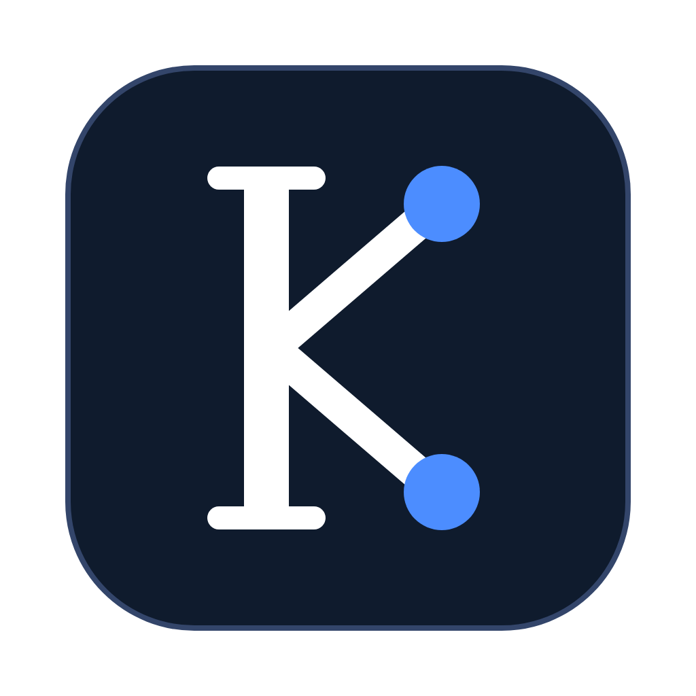
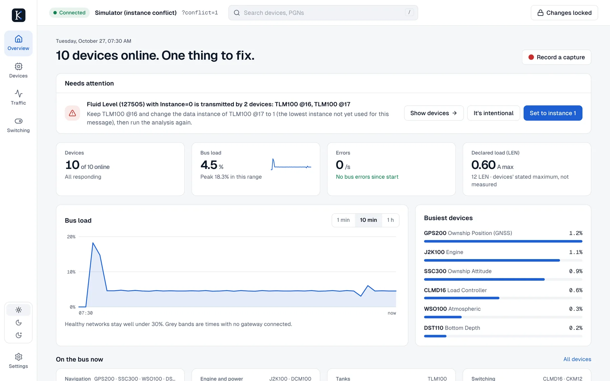
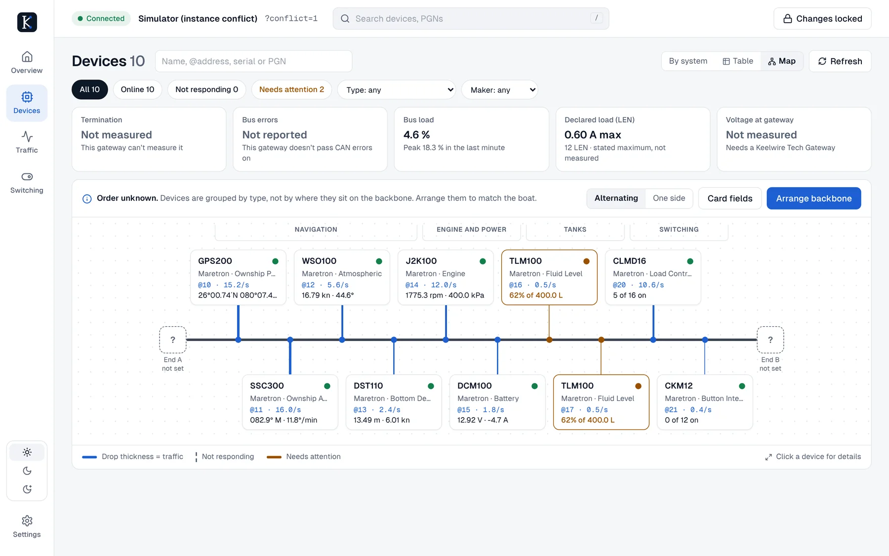
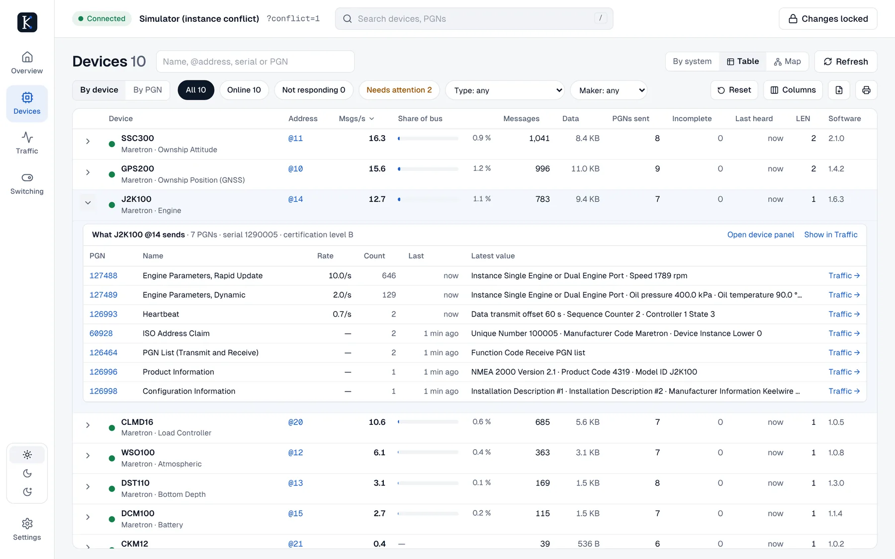
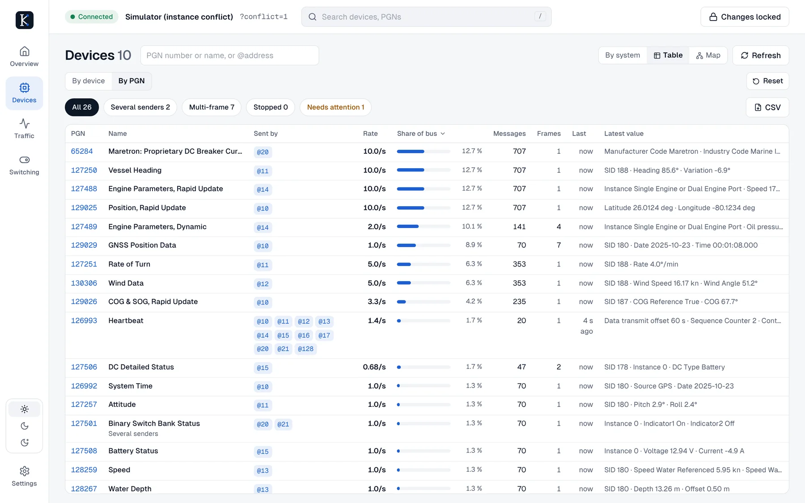

<p align="center"></p>

<h1 align="center">Keelwire</h1>

<p align="center"><b>See what's wrong on a boat's electronics network, fix it safely, and know the fix took.</b><br>
Free and open source · Mac, Windows, Linux and Raspberry Pi · one small program, nothing else to install</p>

<p align="center">
<a href="https://github.com/openseastack/keelwire/releases/latest"><b>Download</b></a> ·
<a href="https://openseastack.github.io/keelwire/"><b>Product tour</b></a> ·
<a href="docs/INSTALL.md">Install guide</a> ·
<a href="docs/SPEC.md">Specification</a>
</p>

<picture><source media="(prefers-color-scheme: dark)" srcset="site/assets/screens/overview-dark.webp"></picture>

Keelwire watches every message on the bus, tells you in plain language what needs attention,
suggests the fix, and checks that the device accepted it. It runs as a desktop app or headless on a
Raspberry Pi serving any phone or laptop aboard, and works with Maretron IPG100, Actisense NGT-1 and
ASCII gateways, Yacht Devices gateways, SocketCAN, a Signal K tap, or capture files.

## The interface

Five places: **Overview** (what needs attention, with one-click fixes, plus bus load and live readings),
**Devices** (grouped by system, a **network map** of the backbone, and **traffic tables** by device or by
PGN; a device panel with live values and settings you stage and apply in one go), **Traffic** (latest
value per message, or every frame), **Switching** and **Settings**. Changes and switching are unlocked
in place and lock again after 15 minutes. Day, Dark and Night (red) themes; works on a phone at the helm.

**Network map.** The backbone with a drop per device, drop thickness following traffic, and the
terminators and power tee. Keelwire never guesses the physical order: until a technician arranges it,
devices are grouped by type and the map says so.

<picture><source media="(prefers-color-scheme: dark)" srcset="site/assets/screens/map-grouped-dark.webp"></picture>

**Traffic tables.** Messages per second, share of the bus, totals, PGNs sent, incomplete multi-frame
messages and LEN for every device, with a column chooser, filters, search and CSV. Expand a device to
see every message it sends, or switch to one row per PGN to find out who is filling the bus.

<table><tr><th>By device</th><th>By PGN</th></tr><tr><td><picture><source media="(prefers-color-scheme: dark)" srcset="site/assets/screens/table-devices-dark.webp"></picture></td><td><picture><source media="(prefers-color-scheme: dark)" srcset="site/assets/screens/table-pgns-dark.webp"></picture></td></tr></table>

See every screen in the [product tour](https://openseastack.github.io/keelwire/). The full specification
is [`docs/SPEC.md`](docs/SPEC.md); Appendix C there is the item-by-item feature checklist.

## What works

| Area | Status |
|---|---|
| Live traffic view with filter expressions, decoding of ~600 PGNs (CANboat database), port/starboard byte-diff colouring | ✔ |
| Fast-packet and ISO transport protocol reassembly | ✔ unit-tested, incl. a real CANboat capture |
| Device list keyed by ISO NAME: all identity columns (incl. data instance, source, bandwidth), column chooser, sorting, print, CSV export | ✔ |
| Transmitted PGNs (per instance, expandable, Clear) and Received PGNs (with field descriptions) windows | ✔ |
| Units (metric / US, per quantity) | ✔ |
| Instancing analysis: 30-second run, specific advice, conflicting devices highlighted | ✔ |
| Data fields: settings held in standard message fields (instances, sources, fluid type, tank capacity, depth offset, battery setup) via 126208 with read-back | ✔ |
| Own address claim with contention handling; discovery requests | ✔ |
| Standard configuration via 126208: device / system instance, installation descriptions, PGN transmit rates, data instances, commanded address | ✔ |
| Switching panel (127501 status, 127502 control, Maretron breaker currents) | ✔ |
| Instance-conflict and duplicate-address analysis, bus load, per-device bandwidth | ✔ |
| Network map (backbone, drops, terminators, power tee; technician-arranged order) and traffic tables by device and by PGN with cumulative counters | ✔ |
| Captures (pcapng / candump / CANboat CSV), live pcap stream, Wireshark extcap | ✔ |
| Boat files (offline analysis), device config files | ✔ |
| Interfaces: SocketCAN, Actisense NGT-1, Yacht Devices RAW, Actisense ASCII, **Maretron IPG100**, Signal K tap, replay, simulator | ✔ |
| Maretron USB100 | ✗ protocol extraction pending |
| Maretron SSC200/SSC300 compass settings (variation source, rate-of-turn damping, installation, calibration) | ✔ reads; some writes marked unconfirmed (expert mode) |
| Tank capacity (TLM100 and other senders) via standard 126208 | ✔ byte-identical to a hardware-confirmed implementation |
| Maretron-style switching (126208 on 127501) alongside 127502 | ✔ |
| Carling digital switching messages | Decoded (from CANboat) |
| Maretron CLMD12/16 breaker & logic, CKM12 settings | ✗ layouts not publicly known yet; schema engine + Maretron message tool ready (spec Appendix A) |
| Firmware updates | ✗ out of scope for v1 |

## Install

Download the installer for your computer from the **Releases** page: a `.dmg` for Mac, a setup
`.exe` for Windows, an `.AppImage` (or `.deb` / `.rpm`) for Linux, or the Raspberry Pi archive
for running it aboard. Nothing else needs to be installed. See [docs/INSTALL.md](docs/INSTALL.md);
maintainers see [docs/RELEASING.md](docs/RELEASING.md).

## Build from source (quick start)

The result is **one self-contained binary** (`keelwire`, or `.exe` on Windows):
the bus engine, REST/WebSocket API and the whole web interface are compiled into it.
Copy it anywhere and run it; nothing else is installed or needed at run time.

```bash
cargo build --release          # builds the web UI too (needs Node.js 20+ on the build machine only)
target/release/keelwire --interface sim:
# your browser opens on http://127.0.0.1:8080 (use --no-browser to stop that);
# without --interface the first screen asks how to connect
```

Rust compiles one binary per platform; CI produces them for Linux x86-64, Raspberry Pi
(aarch64 and armv7), macOS (Apple Silicon and Intel) and Windows. Set
`KEELWIRE_SKIP_UI_BUILD=1` to build without Node.js (a placeholder page is embedded).

Other interfaces:

```bash
keelwire --headless --interface socketcan:can0            # Raspberry Pi CAN HAT
keelwire --interface ipg100:tcp://192.168.1.50:6543        # Maretron IPG100 (6553 = bus 1)
keelwire --interface actisense:/dev/ttyUSB0                # Actisense NGT-1
keelwire --interface ydraw:tcp://192.168.4.1:1457          # Yacht Devices YDWG-02 / YDEN-02
keelwire --interface replay:capture.pcapng?speed=4&loop    # replay a file
keelwire interfaces                                        # list all
keelwire dump -i sim: --decode -n 50                       # print traffic in the terminal
keelwire decode 127250 00393050FF7FFFFD                    # decode one message
```

### Transmit safety

* `--passive`: never transmit.
* Default: the app claims an address and *asks* devices to identify themselves. It never changes settings.
* Changing settings or switching loads needs **both** `--allow-tx` on the server **and** arming TX in Settings (auto-disarms after 15 minutes idle). Raw frame injection and unverified proprietary layouts additionally need Expert mode.

### Testing without a boat

* `sim:` — built-in network of 10 devices (GPS, compass, wind, depth, engine, battery, two tanks, CLMD16 breakers, CKM12 keypad). `sim:?conflict=1` puts both tank senders on instance 0.
* `tools/n2k_sim_send.py` — standard-library Python sender: `--udp 127.0.0.1:1456` (connect with `ydraw:udp://0.0.0.0:1456`), `--tcp-server 1457`, or write `--candump` / `--canboat` files for `replay:`.
* `tools/signalk-keelwire-tap` — Signal K plugin to tap a Signal K server's bus.

### Wireshark

Copy or symlink the `keelwire` binary into Wireshark's personal extcap folder
(Help → About Wireshark → Folders). "Keelwire (marine CAN)" then appears as an
interface; its *Source* option takes `http://host:8080` (a running instance) or an
interface URI. Or pipe the live stream: `curl -sN http://host:8080/api/v1/stream/pcap | wireshark -k -i -`.

## Desktop app (optional)

The plain binary already behaves like a desktop app: double-click it and the UI opens
in your browser. The Tauri build below is only for a native window and installers.

```bash
cargo install tauri-cli --version "^2"
cd crates/keelwire-tauri && cargo tauri build            # current platform
cargo tauri build --target universal-apple-darwin      # macOS Apple Silicon + Intel
```
Linux needs `libwebkit2gtk-4.1-dev libappindicator3-dev librsvg2-dev`. The app embeds the
same server on 127.0.0.1 and opens a native window on it. Start it with `--allow-tx` (or
`KEELWIRE_ALLOW_TX=1`) to permit configuration writes.

## Headless daemon (Raspberry Pi)

`cross build --release -p keelwire-server --target aarch64-unknown-linux-gnu`, then see
`packaging/keelwire.service`.

## Layout

```
crates/keelwire-core     protocol logic (no I/O): CAN ids, fast-packet, ISO TP, CANboat decoder,
                       ISO/NMEA network management, 126208, proprietary schemas, registry,
                       metrics, filter language, pcap, analysis
crates/keelwire-hal      bus drivers + simulator
crates/keelwire-server   engine, REST/WebSocket API, embedded UI, CLI, extcap
crates/keelwire-tauri    desktop wrapper
ui/                    React + Vite + Tailwind web app
tools/                 Python sender, Signal K plugin
```

## Development

```bash
cargo test --workspace
cd ui && npm run dev        # proxies /api and /ws to 127.0.0.1:8080
```

## Licence

Apache-2.0. Includes the CANboat PGN database (Apache-2.0). See NOTICE.

## Trademarks

Keelwire reads and decodes the messages used on NMEA 2000® networks.
NMEA 2000® is a registered trademark of the National Marine Electronics Association (NMEA). Keelwire is not NMEA 2000 Certified and is not affiliated with, sponsored by or endorsed by NMEA. It decodes messages with the open CANboat database, not with NMEA's published standard.

Maretron, Actisense, Yacht Devices, Garmin, Airmar, Simrad, Signal K and other product and company names are trademarks of their respective owners, used only to identify the equipment Keelwire can connect to. Keelwire is not affiliated with, sponsored by or endorsed by any of them. See NOTICE.

